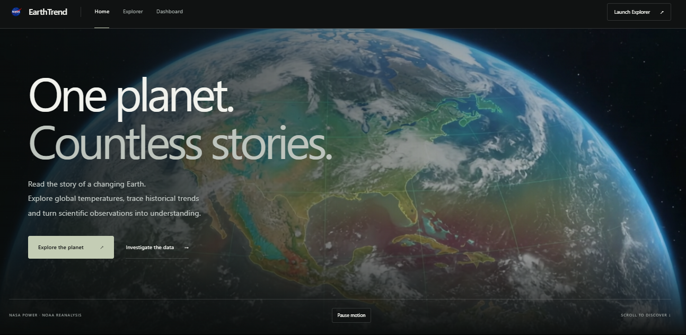
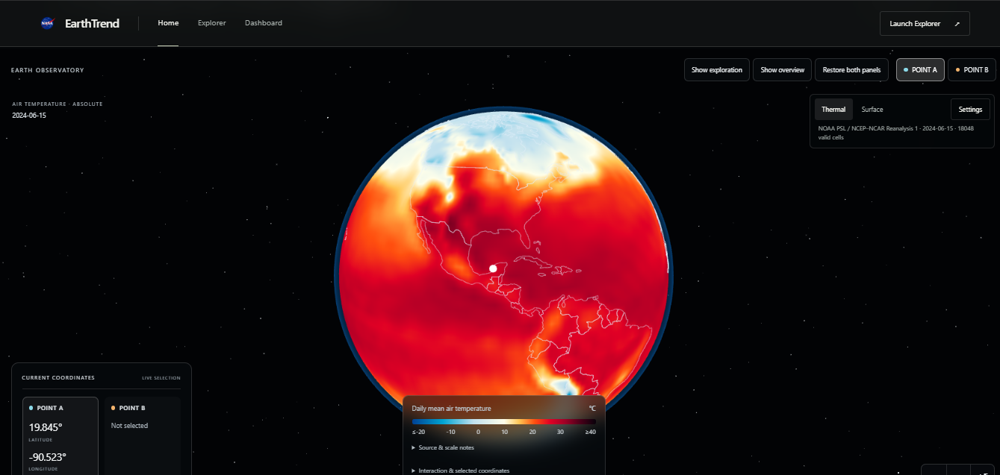
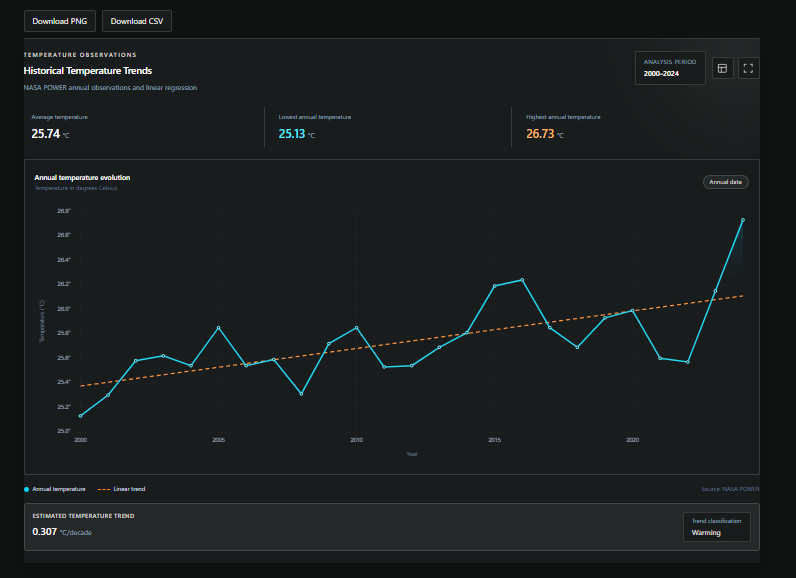
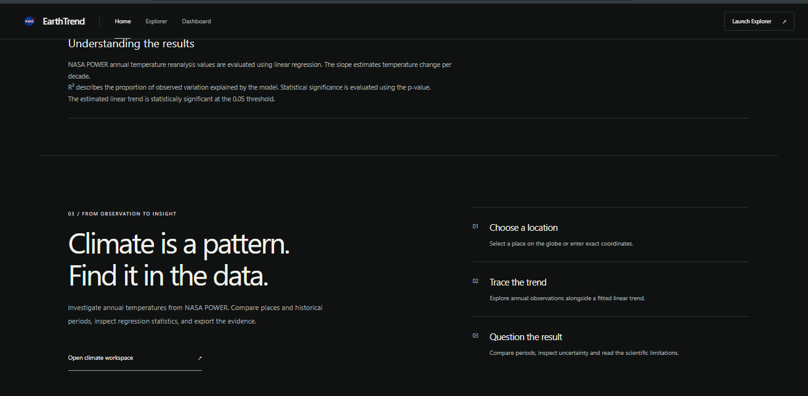
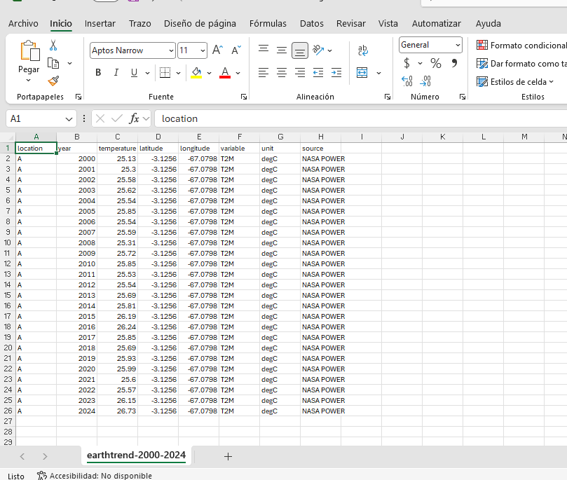
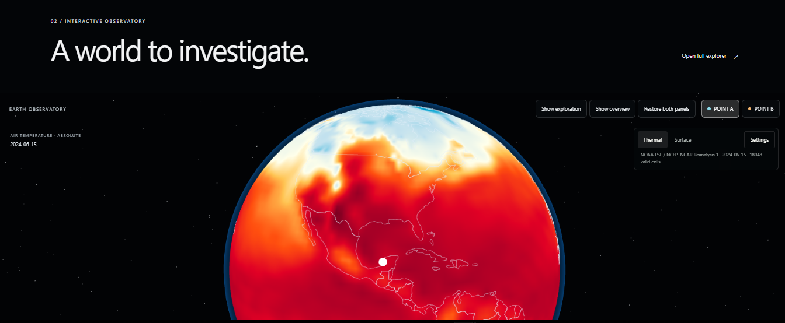

# EarthTrend NASA

**Explore Earth. Understand Climate. Discover Trends.**

An interactive Earth science platform combining a 3D globe, historical climate data, statistical analysis, and scientific visualizations to make climate trends easier to explore and understand.

**Team Feynman | NASA Space Apps Challenge 2026**

[Live Application](https://earth-trend-nasa-2026.vercel.app/) · [GitHub Repository](https://github.com/Ezequie1Sc/EarthTrend-NASA-2026) · [API Documentation](https://earthtrend-nasa-2026.onrender.com/docs) · [Team Feynman](https://www.spaceappschallenge.org/2026/find-a-team/feynman/)

---

## Overview



EarthTrend NASA is a web-based Earth observation and climate analysis platform developed for the **NASA Space Apps Challenge 2026**, addressing the challenge **Be An Earth System Trend Detective!**

The platform transforms complex environmental datasets into an accessible experience where users can explore the planet, investigate historical temperature observations, compare geographic locations, and understand long-term climate trends.

Rather than presenting climate data as isolated numbers, EarthTrend connects geographic exploration with statistical evidence.

The application is designed for students, educators, developers, researchers, and anyone interested in understanding Earth's changing climate.

### The Challenge

Climate datasets are publicly available, but understanding them often requires specialized tools, scientific knowledge, and familiarity with data-processing workflows.

EarthTrend addresses three key challenges:

- **Accessibility:** Making scientific climate information easier to explore.
- **Interpretability:** Turning environmental observations into understandable visualizations.
- **Scientific context:** Distinguishing daily temperature distributions from long-term climate trends.

Our goal is to make climate exploration interactive without compromising scientific transparency.

---

## Explore the Platform

### 01 — Interactive Earth Explorer



Explore Earth through an interactive 3D globe developed with Three.js and WebGL.

The explorer integrates geographic visualization, temperature overlays, coordinate selection, and camera controls into a responsive interface.

**Capabilities**

- Interactive globe rotation and zoom.
- Global temperature visualization.
- Geographic coordinate selection.
- Country boundary overlays.
- Responsive interaction for desktop and mobile.
- Configurable thermal visualization.
- Immersive exploration with optional interface panels.

### 02 — Global Temperature Visualization


The thermal visualization uses gridded atmospheric reanalysis data to display geographic temperature patterns.

Users can examine daily temperature distributions, adjust overlay opacity, and explore the relationship between geographic position and atmospheric conditions.

The temperature scale ranges from **−20 °C to 40 °C**, with saturated endpoints.

Missing observations remain transparent rather than being replaced with invented values.

### 03 — Climate Dashboard


The climate dashboard provides a dedicated workspace for investigating historical temperature behavior.

Users can select geographic coordinates and analysis periods to retrieve annual temperature observations from NASA POWER.

The dashboard presents climate indicators alongside interactive visualizations and statistical summaries.

### 04 — Historical Temperature Trends



EarthTrend analyzes annual mean air temperature at two meters above the surface.

Historical observations are used to calculate linear temperature trends and describe changes over the selected period.

The analysis includes:

- Annual mean temperature.
- Minimum and maximum annual means.
- Linear regression trend.
- Temperature change per decade.
- Coefficient of determination (R²).
- Statistical significance (p-value).

The platform distinguishes statistical associations from causal explanations.

### 05 — Climate Insights


Climate Insights presents calculated results through accessible scientific explanations.

Instead of displaying statistics without context, EarthTrend explains what the results represent and identifies relevant methodological limitations.

The interpretations are based on calculated values rather than AI-generated climate observations.

### 06 — Climate Patterns



Explore temporal patterns through historical observations, trend visualizations, and comparative indicators.

The interface is designed to help users distinguish short-term variability from longer-term temperature behavior.

---

## Climate Comparison Tools

### 07 — Compare Historical Periods


EarthTrend allows users to compare two non-overlapping historical periods using the same temperature variable.

Each period must contain at least three complete years, and both periods must have equal duration.

The comparison includes period means, signed differences, and absolute temperature differences.

The signed difference is calculated as:

**Temperature difference = Period B mean − Period A mean**

All temperature differences are expressed in degrees Celsius.

### 08 — Compare Geographic Locations


Select two geographic locations and compare their historical temperature observations.

EarthTrend uses the same variable, period, and measurement units for both locations.

The resulting visualization displays both annual series and their fitted trends.

### 09 — Location A and Location B


Geographic coordinates can be selected interactively or entered manually.

The globe uses distinct markers to identify locations A and B, allowing users to maintain geographic context while examining statistical differences.

Selecting a location does not automatically initiate historical analysis. Data retrieval is performed when the user requests it.

### 10 — Comparative Analysis


Comparison results provide a structured interpretation of differences between geographic locations or historical periods.

These tools are intended to support exploration and education, not to establish causal climate attribution.

---

## Scientific Methodology


EarthTrend is designed around reproducible statistical calculations and clearly identified scientific data sources.

### Data Sources

| Source | Purpose | Data |
|---|---|---|
| NASA POWER | Historical climate analysis | Annual mean T2M temperature |
| NOAA NCEP–NCAR Reanalysis 1 | Default globe temperature layer | Daily mean air temperature at 2 m |
| NASA MERRA-2 | Optional thermal dataset | Imported daily mean T2M |

**NASA POWER**

NASA POWER provides the historical temperature observations used for annual trend analysis.

EarthTrend uses the annual aggregate supplied by the POWER monthly endpoint rather than fabricating missing observations.

**NOAA NCEP–NCAR Reanalysis 1**

The default thermal layer uses gridded atmospheric reanalysis data.

Its native grid contains 192 × 94 cells, with approximately 1.9° spatial resolution.

**NASA MERRA-2**

MERRA-2 is supported as an optional imported dataset. It is not available in the globe until the required daily data have been imported.

### Linear Trend Analysis

EarthTrend applies ordinary least squares regression to annual mean temperature observations:

**T = a + b × year**

The temperature trend per decade is calculated as:

**Trend (°C/decade) = 10 × b**

Where:

- **T:** Annual mean temperature.
- **a:** Regression intercept.
- **b:** Estimated annual temperature slope.

The platform also reports R² and a two-sided p-value under the assumptions of ordinary least squares.

Statistical significance does not establish causality, and a nonsignificant result should not be interpreted as proof of climate stability.

### Scientific Limitations

EarthTrend explicitly recognizes that:

- Reanalysis data combine numerical models and observations.
- Gridded temperatures do not represent exact point measurements.
- Short historical periods do not constitute 30-year climate normals.
- Linear trends do not capture every form of climate variability.
- Statistical results do not establish the causes of temperature changes.
- Historical data can be revised by their providers.
- The current regression does not adjust uncertainty for annual autocorrelation.

### Scientific References

- [NASA POWER — Monthly and Annual API](https://power.larc.nasa.gov/docs/services/api/temporal/monthly/)
- [NASA POWER — Temporal Processing](https://power.larc.nasa.gov/docs/methodology/data/processing/)
- [NASA POWER — Meteorological Data Sources](https://power.larc.nasa.gov/docs/methodology/data/sources_meteorology/)
- [NOAA — NCEP/NCAR Reanalysis](https://psl.noaa.gov/data/gridded/data.ncep.reanalysis.html)
- [NASA MERRA-2](https://doi.org/10.5067/VJAFPLI1CSIV)

---

## Data Export

### CSV Export


EarthTrend supports CSV export of the displayed annual observations, including geographic coordinates, temperature values, variable information, measurement units, and source metadata.

### Data Inspection



Exported observations can be inspected using spreadsheet software or incorporated into external analytical workflows.

### PNG Export


Users can export composed chart images containing the visualization, title, analysis period, geographic coordinates, units, and scientific provenance.

---

## Technology Stack

EarthTrend uses a modular frontend and backend architecture.

| Layer | Technologies |
|---|---|
| Frontend | Angular 22, TypeScript, Tailwind CSS |
| 3D Visualization | Three.js, WebGL |
| Charts | Chart.js |
| Reactive Programming | RxJS |
| Backend | Python, FastAPI |
| HTTP Integration | HTTPX |
| Scientific Computing | NumPy, SciPy, xarray |
| Frontend Hosting | Vercel |
| Backend Hosting | Render |
| Version Control | Git, GitHub |

### Architecture

```text
EarthTrend-NASA-2026/
├── frontend/
│   ├── public/
│   └── src/
│       └── app/
│           ├── core/
│           │   ├── models/
│           │   ├── services/
│           │   └── utils/
│           ├── features/
│           │   ├── home/
│           │   ├── earth-explorer/
│           │   └── dashboard/
│           └── shared/
│
├── backend/
│   ├── app/
│   │   ├── api/
│   │   │   └── routes/
│   │   ├── schemas/
│   │   └── services/
│   ├── data/
│   └── scripts/
│
└── README.md
```

The frontend is organized into reusable standalone Angular features.

FastAPI handles scientific data retrieval, validation, processing, and statistical analysis.

The thermal globe pipeline and historical NASA POWER analysis are separate workflows.

The application does not require a database or user authentication.

---

## API

The backend exposes REST endpoints for climate exploration and analysis.

**Base URL**

https://earthtrend-nasa-2026.onrender.com

**Interactive API documentation**

https://earthtrend-nasa-2026.onrender.com/docs

### Available Endpoints

| Method | Endpoint | Description |
|---|---|---|
| GET | `/health` | API health |
| GET | `/api/v1/climate/temperature` | Historical temperature observations |
| GET | `/api/v1/analysis/trends` | Statistical trend analysis |
| GET | `/api/v1/thermal/sources` | Available thermal datasets |
| GET | `/api/v1/thermal/grid` | Daily temperature grid |

Example:

```http
GET /api/v1/thermal/grid?date=2024-06-15&provider=noaa
```

API responses depend on the availability of upstream scientific data services.

---

## Local Development

### Requirements

- Node.js 24
- pnpm
- Python 3.12 or later
- Git

### Clone the Repository

```powershell
git clone https://github.com/Ezequie1Sc/EarthTrend-NASA-2026.git
cd EarthTrend-NASA-2026
```

### Start the Backend

```powershell
cd backend

python -m venv .venv

.\.venv\Scripts\Activate.ps1

python -m pip install -r requirements.txt

python -m uvicorn app.main:app --reload --port 8000
```

### Start the Frontend

Open another terminal:

```powershell
cd frontend

pnpm install

pnpm start
```

Open:

http://localhost:4200

The frontend can communicate with a locally running FastAPI instance through its configured development proxy or with the deployed Render API, depending on the active `API_URL` configuration.

### Production Build

```powershell
cd frontend
pnpm exec ng build
```

### Backend Tests

```powershell
cd backend
python -m pytest -q
```

---

## Deployment

The application is deployed as two independent services.

**Frontend — Vercel**

https://earth-trend-nasa-2026.vercel.app/

**Backend — Render**

https://earthtrend-nasa-2026.onrender.com/

**API Documentation**

https://earthtrend-nasa-2026.onrender.com/docs

Deployment configuration and additional operational details are documented in [docs/DEPLOYMENT.md](docs/DEPLOYMENT.md).

---

## Interface Design

EarthTrend follows a scientific dashboard design language emphasizing clarity, geographic context, responsive layouts, and readable data visualizations.


The interface combines interactive visualizations with restrained colors, typography, layered surfaces, and modular information panels.

### Additional Interface Details



### Footer and Project Information


---

## Current Limitations

The project currently has several known limitations:

- NASA MERRA-2 thermal visualization requires a valid dataset import.
- Scientific requests depend on NASA and NOAA service availability.
- Render cold starts can increase initial response times.
- Mobile interactions require additional physical-device validation.
- WebGL performance varies across devices.
- No causal climate attribution or climate forecasting is implemented.
- Statistical uncertainty is not adjusted for annual autocorrelation.

The platform is intended for educational exploration and scientific data interpretation, not operational weather forecasting.

---

## NASA Space Apps Challenge 2026

**Challenge:** Be An Earth System Trend Detective!

**Team:** Feynman

**Project:** EarthTrend NASA

EarthTrend was developed as an independent participant project for NASA Space Apps Challenge 2026.

The project demonstrates how open scientific datasets, interactive visualization, and modern web technologies can help make Earth system information more accessible.

[View Team Feynman](https://www.spaceappschallenge.org/2026/find-a-team/feynman/)

[Explore the NASA Space Apps Challenge](https://www.spaceappschallenge.org/2026/challenges/earth-system-trend-detective/)

---

## Development and AI Assistance

AI-assisted development tools, including ChatGPT/Codex, supported parts of code inspection, implementation, testing, and technical documentation.

Scientific observations originate from the cited NASA and NOAA datasets. Generative AI is not used to fabricate temperature measurements.

Statistical calculations and explanatory interpretations are based on deterministic application logic.

---

## Developer

**Orlando Ezequiel Salazar Cruz**

Software Developer · Computer Systems Engineering

GitHub: [Ezequie1Sc](https://github.com/Ezequie1Sc)

Portfolio: [ezequiel-dev-ia.vercel.app](https://ezequiel-dev-ia.vercel.app/)

---

**EarthTrend NASA — Explore Earth. Understand Climate. Discover Trends.**

*An independent NASA Space Apps Challenge participant project. Not an official NASA product or NASA-endorsed application.*