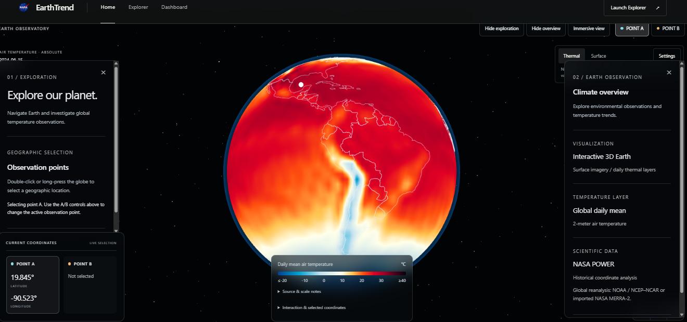
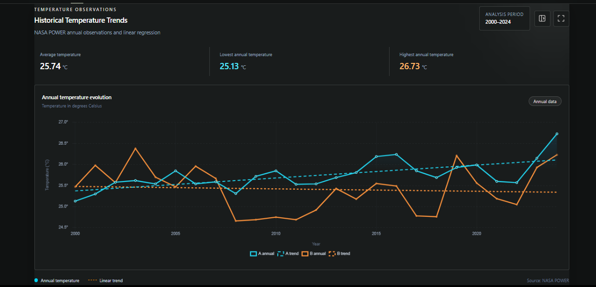
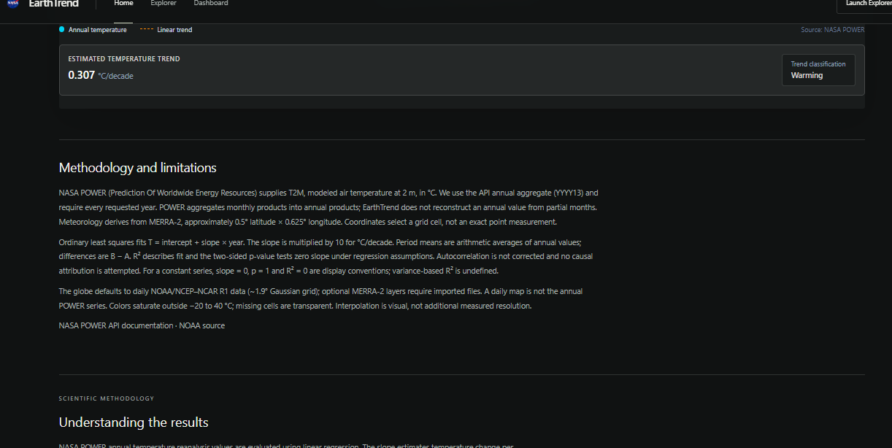
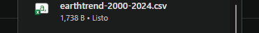
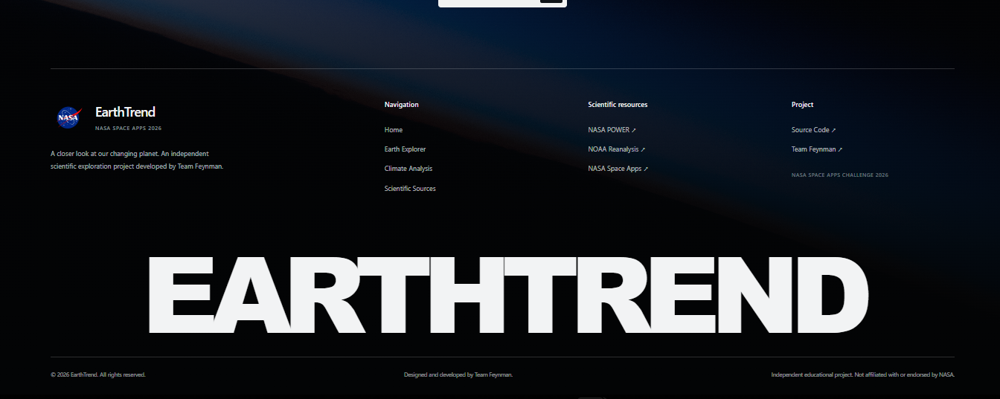
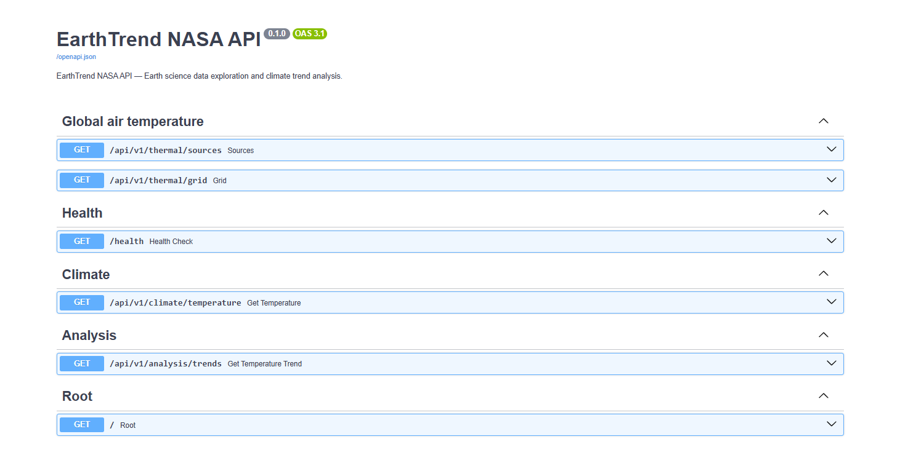

# EarthTrend NASA

### Explore Earth. Understand Climate. Discover Trends.

**An interactive Earth science platform for exploring global temperature patterns, analyzing historical climate observations, and understanding long-term environmental trends.**

**NASA Space Apps Challenge 2026 · Team Feynman**

[**Live Application**](https://earth-trend-nasa-2026-5hti.vercel.app/) · [**API Documentation**](https://earthtrend-nasa-2026.onrender.com/docs) · [**Source Code**](https://github.com/Ezequie1Sc/EarthTrend-NASA-2026) · [**Team Feynman**](https://www.spaceappschallenge.org/2026/find-a-team/feynman/)

---


## 01. Project Overview

**EarthTrend NASA** is an interactive climate exploration and scientific data analysis platform developed for the **NASA Space Apps Challenge 2026**, addressing the challenge **Be An Earth System Trend Detective!**

The project combines three-dimensional Earth visualization, historical climate datasets, statistical analysis, and interactive charts within a unified web application.

Its purpose is to help users move beyond simply observing temperature maps and begin investigating meaningful scientific questions:

- How has the average temperature of a particular location changed over time?
- What differences exist between historical climate periods?
- How do temperature trends compare between two geographic locations?
- What can statistical analysis tell us about observed changes?
- How can complex environmental datasets become more accessible to students and the general public?

EarthTrend provides an integrated environment where users can explore geographic regions, select coordinates, retrieve historical observations, visualize annual temperature trends, compare results, and export data for further analysis.

The platform is designed to make Earth science more approachable while preserving the distinction between scientific observations, statistical trends, and causal interpretations.

### Our Mission

To make climate information accessible, interactive, and understandable through open scientific data, modern web technologies, and transparent analytical methods.

---

## 02. The Problem

Climate change and environmental variability are among the most important scientific challenges of our time.

Organizations such as NASA and NOAA provide extensive environmental datasets. However, accessing and interpreting this information can be difficult for people without experience in climate science, geospatial visualization, or statistical analysis.

Several challenges remain:

**Data accessibility**

Scientific information is distributed across different platforms, services, formats, and geographic grids.

**Interpretation**

Raw temperature observations do not automatically explain historical patterns or long-term changes.

**Geographic context**

Traditional charts can make it difficult to connect statistical results with the locations they represent.

**Scientific understanding**

Daily weather conditions, historical climate trends, and statistical significance are often confused.

**Technical complexity**

Many scientific workflows require programming knowledge, specialized software, or data-processing experience.

EarthTrend addresses these challenges through an accessible web interface that connects geographic exploration with reproducible statistical analysis.

---

## 03. Our Solution

EarthTrend integrates multiple scientific workflows into a single platform.

Users begin by exploring Earth through an interactive three-dimensional globe. They can examine global temperature distributions, identify geographic locations, and use selected coordinates to perform historical analysis.

The application retrieves environmental observations from scientific data providers, processes the information through a Python backend, and presents the results using interactive charts and explanatory summaries.

### Core Capabilities

| Capability | Description |
|---|---|
| Interactive 3D Earth | Explore geographic regions through a Three.js globe |
| Global thermal visualization | Display daily gridded temperature distributions |
| Geographic selection | Select and inspect latitude and longitude |
| Historical analysis | Retrieve annual temperature observations |
| Climate trend detection | Calculate linear temperature trends |
| Period comparison | Compare two historical periods |
| Location comparison | Compare temperature behavior at two locations |
| Scientific insights | Interpret calculated statistics and limitations |
| Data export | Export annual observations and charts |
| Responsive interface | Access the application across screen sizes |

---

# 04. Platform Experience

## Interactive Earth Explorer


The Earth Explorer is one of the central components of the platform.

Developed using **Three.js and WebGL**, it presents an interactive representation of Earth that connects geographic navigation with environmental information.

Users can rotate the globe, adjust the camera, inspect coordinates, and explore geographic temperature patterns.

The experience includes:

- Three-dimensional Earth rendering.
- Surface and temperature visualization modes.
- Interactive camera controls.
- Geographic coordinate selection.
- Country boundary overlays.
- Location markers.
- Optional interface panels.
- Responsive layouts.
- Temperature visualization controls.

The explorer is designed to provide geographic context before users begin more detailed statistical investigations.

### Additional Earth Explorer Views




These views document additional states of the explorer and its geographic visualization interface.

---

## Global Temperature Visualization

The thermal layer represents daily air-temperature distributions using gridded atmospheric reanalysis data.

The default source is **NOAA NCEP–NCAR Reanalysis 1**, which provides historical atmospheric information suitable for exploring large-scale temperature patterns.

The visualization uses a shared temperature scale between the rendered raster and the legend.

### Thermal Visualization Features

- Daily temperature grids.
- Temperature values expressed in degrees Celsius.
- Adjustable thermal overlay opacity.
- Dataset and date selection.
- Geographic boundary references.
- Transparent representation of missing data.
- Worker-based raster processing.
- Loading, retry, and error states.

The visualization is intended to communicate geographic temperature patterns rather than exact measurements at individual geographic points.

---

## Climate Dashboard


The Climate Dashboard provides a dedicated workspace for historical environmental analysis.

Users can specify geographic coordinates and select a period of interest to retrieve annual mean temperature observations.

The interface connects user-selected parameters with statistical results and visual representations.

### Historical Analysis Workflow

1. Select a geographic location.
2. Define the historical analysis period.
3. Request temperature observations.
4. Retrieve data through the FastAPI backend.
5. Calculate statistical indicators.
6. Visualize annual temperature behavior.
7. Interpret the resulting trends.
8. Export observations or charts.

### Temperature Analysis


The application uses annual mean air temperature at two meters above the surface, identified as **T2M**.

Historical analysis focuses on annual observations rather than interpreting isolated daily temperatures as evidence of long-term climate change.

---

## Climate Insights


EarthTrend presents calculated statistical results alongside explanations intended to help users understand their meaning.

The insights interface connects quantitative analysis with scientific interpretation.

It provides context for concepts such as:

- Average annual temperature.
- Temperature trends.
- Historical variability.
- Differences between geographic locations.
- Statistical significance.
- Limitations of linear regression.

Scientific explanations are based on deterministic application logic and calculated statistics, rather than AI-generated temperature observations.

---

## Climate Patterns


Climate patterns can be explored through annual temperature observations and statistical visualizations.

EarthTrend helps users examine how temperature values vary across a selected period and how an estimated linear trend relates to those observations.

A historical temperature trend describes a statistical relationship over time. It does not independently establish the physical causes of the observed changes.

---

# 05. Climate Comparison

EarthTrend includes tools for investigating differences across time and geographic space.

## Historical Period Comparison



Users can compare the mean temperature of two separate historical periods.

The application requires the periods to be non-overlapping, of equal duration, and at least three complete years long.

For example, a user might compare an earlier period with a more recent period to investigate differences in annual mean temperature.

The comparison uses:

**Difference = Mean temperature of Period B − Mean temperature of Period A**

A positive result indicates that Period B has a higher mean temperature than Period A.

A negative result indicates the opposite.

The platform also reports the absolute magnitude of the difference.

All temperature differences are expressed in degrees Celsius.

These comparisons are not presented as 30-year climatological normals unless the underlying periods satisfy that definition.

---

## Geographic Location Comparison


EarthTrend allows users to compare historical temperature observations between two geographic locations.

Each location is identified using latitude and longitude.

Both locations are analyzed using the same temperature variable, measurement units, and historical period.

The comparison presents two annual temperature series and their corresponding fitted trends.

This makes it possible to investigate geographic differences while maintaining consistent analytical parameters.

### Location Selection


Locations can be selected interactively through the globe or entered manually.

Distinct visual markers help users distinguish between the selected geographic points.

### Comparative Results


The resulting visualizations support side-by-side investigation of annual observations, estimated trends, and geographic differences.

EarthTrend does not interpret geographic differences as proof of climate causation.

---

# 06. Scientific Data Sources

EarthTrend integrates environmental information from established scientific providers.

## NASA POWER

**Prediction Of Worldwide Energy Resources**

NASA POWER provides the historical meteorological observations used by EarthTrend for annual temperature analysis.

The application retrieves T2M data and uses the annual aggregates supplied by the NASA POWER service.

**Application:** Historical temperature analysis, statistical trends, and comparisons.

**Variable:** T2M — air temperature at two meters.

**Unit:** Degrees Celsius.

Official resource: https://power.larc.nasa.gov/

## NOAA NCEP–NCAR Reanalysis 1

The NOAA NCEP–NCAR Reanalysis 1 dataset provides atmospheric reanalysis information for global temperature visualization.

EarthTrend uses daily mean air-temperature data at two meters above the surface.

**Application:** Global thermal layer.

**Grid:** 192 × 94.

**Approximate resolution:** 1.9° latitude and 1.875° longitude.

**Unit conversion:** Kelvin to degrees Celsius where required.

Official resource: https://psl.noaa.gov/data/gridded/data.ncep.reanalysis.html

## NASA MERRA-2

**Modern-Era Retrospective Analysis for Research and Applications, Version 2**

MERRA-2 is an atmospheric reanalysis product developed by NASA.

EarthTrend includes an optional import workflow for daily MERRA-2 temperature data.

**Dataset:** M2T1NXSLV.

**Grid:** 576 × 361.

**Resolution:** 0.5° latitude × 0.625° longitude.

**Current availability:** Requires importing a valid daily dataset.

MERRA-2 is not presented as an automatically available thermal source until the required data have been imported.

Official reference: https://doi.org/10.5067/VJAFPLI1CSIV

### Data Source Comparison

| Dataset | Main Purpose | Temporal Representation |
|---|---|---|
| NASA POWER | Historical analysis | Annual mean temperature |
| NOAA NCEP–NCAR R1 | Global thermal visualization | Daily mean temperature |
| NASA MERRA-2 | Optional thermal visualization | Imported daily mean temperature |

---

# 07. Scientific Methodology



Scientific transparency is an important principle of EarthTrend.

The platform distinguishes data retrieval, statistical processing, visualization, and interpretation.

## Annual Temperature Observations

NASA POWER supplies historical meteorological observations.

EarthTrend uses annual aggregates from the POWER monthly endpoint, including the annual value represented by `YYYY13`.

The application does not fabricate missing observations or automatically substitute incomplete historical periods with simulated values.

Missing, invalid, nonfinite, or unsupported observations are handled as data-quality errors.

## Linear Regression

EarthTrend applies ordinary least squares regression to annual mean temperature observations.

The fitted model is:

\[
T(y) = a + by
\]

Where:

- \(T(y)\) is the estimated annual mean temperature.
- \(y\) is the year.
- \(a\) is the regression intercept.
- \(b\) is the annual temperature slope.

The slope is estimated as:

\[
b =
\frac{\sum_i(y_i-\bar y)(T_i-\bar T)}
{\sum_i(y_i-\bar y)^2}
\]

The decadal temperature trend is:

\[
\text{Trend}_{10y} = 10b
\]

The result is expressed in **°C per decade**.

## Statistical Indicators

| Indicator | Interpretation |
|---|---|
| Mean temperature | Average of the selected annual observations |
| Minimum annual mean | Lowest annual mean within the selected period |
| Maximum annual mean | Highest annual mean within the selected period |
| Linear trend | Estimated rate of temperature change |
| R² | Proportion of variance described by the fitted model |
| p-value | Statistical evidence concerning a zero-slope hypothesis |

The reported p-value is based on ordinary least squares assumptions.

Annual autocorrelation is not currently corrected in the uncertainty estimate.

A nonsignificant trend is considered statistically inconclusive rather than evidence that the climate is stable.

## Scientific Integrity

EarthTrend follows several important principles:

- Historical temperature observations originate from scientific datasets.
- Missing climate values are not replaced with AI-generated data.
- Geographic grid cells are not described as exact point measurements.
- Statistical trends are not treated as causal attribution.
- Daily temperature patterns are distinguished from long-term historical trends.
- Exported data retain relevant scientific provenance.
- Visualization interpolation does not increase the underlying scientific resolution.

---

# 08. Data Visualization and Export

EarthTrend allows users to inspect and export the information displayed in the climate dashboard.

## CSV Export



Annual observations can be exported in CSV format for external inspection and analysis.

Exported information includes the relevant annual values, coordinates, units, variable identification, and scientific source.

## Spreadsheet Inspection


The exported data can be opened using spreadsheet applications or processed through external analytical tools.

This supports reproducibility and enables further independent exploration.

## Chart Export


The platform also supports exporting chart compositions as PNG images.

The exported visualization is designed to preserve useful context, including the title, analysis period, measurement units, geographic coordinates, and source information.

---

# 09. User Interface and Experience

EarthTrend uses a modern scientific dashboard design language.

The interface emphasizes clarity, readable information, geographic context, and consistent visual hierarchy.

## Interface Design


The visual system combines dark surfaces, structured layouts, interactive components, and restrained accent colors.

Its purpose is to maintain focus on scientific information without overwhelming the user.

## Additional Interface


The application organizes its functionality into dedicated views for geographic exploration, climate analysis, and supporting information.

## Application Footer




The interface also includes project information and supporting navigation elements.

---

# 10. System Architecture

EarthTrend follows a modular client-server architecture.

The frontend handles interaction, visualization, navigation, and presentation.

The backend handles scientific data retrieval, validation, processing, and statistical analysis.

```text
                  EARTHTREND NASA
                         |
              Angular 22 Frontend
                         |
          +--------------+--------------+
          |              |              |
       Home Page     Earth Explorer   Dashboard
                         |              |
                     Three.js        Chart.js
                         |              |
                         +------+-------+
                                |
                           HTTP / REST
                                |
                          FastAPI Backend
                                |
              +-----------------+----------------+
              |                 |                |
          Climate API       Thermal API     Analysis API
              |                 |                |
          NASA POWER       NOAA / MERRA-2   NumPy / SciPy
              |                 |                |
              +-----------------+----------------+
                                |
                       Scientific Results
                                |
                       Angular Visualizations
```

## Frontend Architecture

The frontend is developed with Angular 22 and TypeScript.

It uses standalone components and feature-oriented organization.

```text
frontend/
├── public/
│   └── prueba/
├── src/
│   └── app/
│       ├── core/
│       │   ├── models/
│       │   ├── services/
│       │   └── utils/
│       ├── features/
│       │   ├── home/
│       │   ├── earth-explorer/
│       │   └── dashboard/
│       └── shared/
├── angular.json
└── package.json
```

### Frontend Responsibilities

- Application routing.
- Responsive interface rendering.
- Interactive Earth visualization.
- Geographic coordinate selection.
- HTTP communication.
- Historical data visualization.
- Chart interactions.
- Comparison presentation.
- Data export.

## Backend Architecture

The backend is developed with Python and FastAPI.

```text
backend/
├── app/
│   ├── api/
│   │   └── routes/
│   ├── core/
│   ├── schemas/
│   └── services/
├── data/
├── scripts/
└── requirements.txt
```

### Backend Responsibilities

- Scientific API integration.
- Input validation.
- Historical data retrieval.
- Temperature grid processing.
- Statistical calculations.
- Response serialization.
- Scientific data provenance.
- Error handling.

The application does not require a database or user authentication.

---

# 11. Technology Stack

| Category | Technology |
|---|---|
| Frontend framework | Angular 22 |
| Programming language | TypeScript |
| Styling | Tailwind CSS |
| 3D graphics | Three.js |
| Graphics rendering | WebGL |
| Data visualization | Chart.js |
| Reactive programming | RxJS |
| Backend framework | FastAPI |
| Backend language | Python |
| HTTP client | HTTPX |
| Numerical processing | NumPy |
| Statistical analysis | SciPy |
| Scientific data processing | xarray |
| Frontend deployment | Vercel |
| Backend deployment | Render |
| Version control | Git and GitHub |

### Why These Technologies?

**Angular** provides a structured architecture for maintaining a complex interactive application.

**Three.js** enables three-dimensional geographic exploration through browser-based graphics.

**Chart.js** provides interactive visualization of historical temperature observations.

**FastAPI** offers typed REST endpoints and automatic OpenAPI documentation.

**NumPy and SciPy** support deterministic numerical calculations and statistical analysis.

**Vercel and Render** allow the frontend and backend to be deployed independently.

---

# 12. REST API



EarthTrend exposes a REST API developed with FastAPI.

**Production API**

https://earthtrend-nasa-2026.onrender.com/

**Interactive Documentation**

https://earthtrend-nasa-2026.onrender.com/docs

### Main Endpoints

| Method | Endpoint | Purpose |
|---|---|---|
| GET | `/health` | Health information |
| GET | `/api/v1/climate/temperature` | Historical temperature observations |
| GET | `/api/v1/analysis/trends` | Temperature trend analysis |
| GET | `/api/v1/thermal/sources` | Available thermal data sources |
| GET | `/api/v1/thermal/grid` | Daily temperature grid |

### Example Request

```http
GET https://earthtrend-nasa-2026.onrender.com/api/v1/thermal/grid?date=2024-06-15&provider=noaa
```

The API is documented through Swagger UI and OpenAPI.

Responses depend on the availability of the corresponding scientific datasets and upstream services.

---

# 13. Installation and Local Development

## Requirements

- Node.js 24
- pnpm
- Python 3.12 or later
- Git
- A modern browser with WebGL support

## Clone the Repository

```powershell
git clone https://github.com/Ezequie1Sc/EarthTrend-NASA-2026.git

cd EarthTrend-NASA-2026
```

## Backend Setup

Open a PowerShell terminal:

```powershell
cd backend

python -m venv .venv

.\.venv\Scripts\Activate.ps1

python -m pip install -r requirements.txt

python -m uvicorn app.main:app --reload --port 8000
```

The local backend will be available at:

http://127.0.0.1:8000

API documentation:

http://127.0.0.1:8000/docs

## Frontend Setup

Open a second terminal:

```powershell
cd frontend

pnpm install

pnpm start
```

The Angular development server will be available at:

http://localhost:4200

**API configuration:** The frontend uses the `API_URL` injection token defined in `frontend/src/app/core/services/api-url.ts`. The current production configuration points to the Render API. To use the local backend, configure the token to use `/api/v1` through the Angular development proxy.

## Production Build

```powershell
cd frontend

pnpm exec ng build
```

## Backend Tests

```powershell
cd backend

python -m pytest -q
```

Additional verification details are available in [docs/VERIFICATION.md](docs/VERIFICATION.md).

---

# 14. Deployment

EarthTrend is deployed using two independent services.

## Frontend — Vercel

**Live Application**

https://earth-trend-nasa-2026-5hti.vercel.app/

Vercel builds and hosts the Angular application.

### Build Configuration

| Setting | Value |
|---|---|
| Framework | Angular |
| Root Directory | `frontend` |
| Install Command | `pnpm install` |
| Build Command | `pnpm exec ng build` |
| Output Directory | `dist/frontend/browser` |

## Backend — Render

**API**

https://earthtrend-nasa-2026.onrender.com/

**Swagger Documentation**

https://earthtrend-nasa-2026.onrender.com/docs

Render hosts the FastAPI application and exposes the scientific REST endpoints.

The frontend communicates with the backend through HTTPS requests.

Additional deployment instructions are available in [docs/DEPLOYMENT.md](docs/DEPLOYMENT.md).

---

# 15. Project Screenshots

The following gallery brings together the interface screenshots included in the repository.

### Homepage


### Main Interface


### Earth Explorer


### Historical Analysis


### Climate Insights


### Comparisons


### Data Export


### Scientific Methodology


### Backend


### Footer


---

# 16. Known Limitations

EarthTrend is an educational and exploratory scientific application.

Current limitations include:

- NASA MERRA-2 requires importing a valid daily dataset before its thermal layer becomes available.
- Historical data retrieval depends on NASA POWER service availability.
- Daily thermal data availability depends on NOAA archives or locally available cached datasets.
- Render cold starts can increase initial response latency.
- WebGL performance varies depending on browser and device capabilities.
- Physical mobile-device interaction requires additional validation.
- Linear regression does not provide causal climate attribution.
- Statistical uncertainty is not adjusted for annual autocorrelation.
- No future climate forecasting is implemented.
- Historical source datasets may be revised by their providers.

The application is not intended to replace operational meteorological systems or professional climate research tools.

---

# 17. NASA Space Apps Challenge 2026

**Team:** Feynman

**Project:** EarthTrend NASA

**Challenge:** Be An Earth System Trend Detective!

EarthTrend was developed as an independent participant project for the NASA Space Apps Challenge 2026.

The project demonstrates how open scientific data, geospatial visualization, statistical analysis, and modern software engineering can be combined to create accessible Earth science experiences.

Our approach emphasizes three principles:

**Explore:** Make geographic and environmental information interactive.

**Analyze:** Use reproducible calculations to investigate historical observations.

**Understand:** Communicate statistical results with appropriate scientific context.

### Official Links

[Team Feynman](https://www.spaceappschallenge.org/2026/find-a-team/feynman/)

[NASA Space Apps Challenge 2026](https://www.spaceappschallenge.org/)

[Be An Earth System Trend Detective!](https://www.spaceappschallenge.org/2026/challenges/earth-system-trend-detective/)

---

# 18. AI Assistance and Scientific Transparency

AI-assisted development tools, including ChatGPT/Codex, supported aspects of software implementation, code inspection, testing, and documentation.

Climate observations originate from the cited scientific sources.

Generative AI is not used to fabricate historical temperature measurements.

Statistical calculations and application-generated explanations are based on deterministic logic and retrieved environmental data.

The developer remains responsible for reviewing the implementation, validating scientific outputs, and verifying application behavior.

---

# 19. Developer

**Orlando Ezequiel Salazar Cruz**

Computer Systems Engineering · Software Developer

**GitHub:** [Ezequie1Sc](https://github.com/Ezequie1Sc)

**Portfolio:** [ezequiel-dev-ia.vercel.app](https://ezequiel-dev-ia.vercel.app/)

**Project Repository:** [EarthTrend-NASA-2026](https://github.com/Ezequie1Sc/EarthTrend-NASA-2026)

---

## Acknowledgments

EarthTrend uses open scientific information and technical resources provided by NASA, NOAA, and the open-source community.

We acknowledge the researchers, engineers, and organizations responsible for maintaining these environmental datasets and making Earth observation information publicly accessible.

---

**EarthTrend NASA**

*Explore Earth. Understand Climate. Discover Trends.*

Developed by **Team Feynman** for the **NASA Space Apps Challenge 2026**.

*This is an independent participant project and is not an official NASA product or a NASA-endorsed application.*