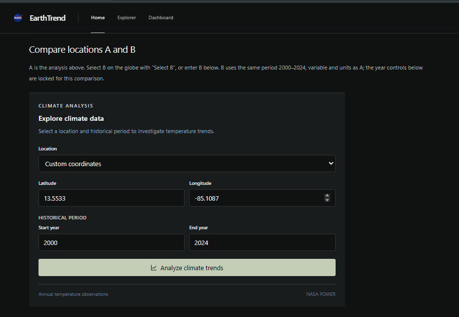
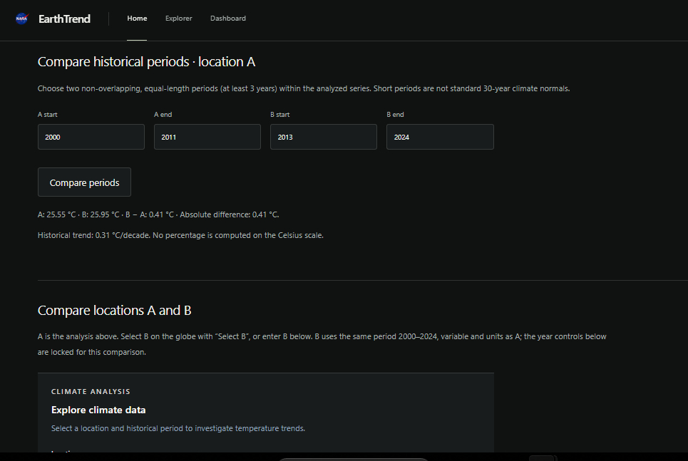
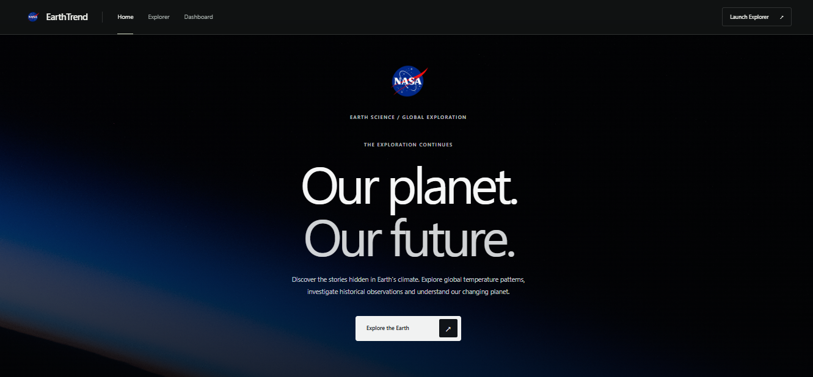

# EarthTrend NASA

### Explore Earth. Understand Climate. Discover Trends.

**An interactive Earth science platform for exploring global temperature patterns, analyzing historical climate observations, and understanding long-term environmental trends.**

**NASA Space Apps Challenge 2026 | Team Feynman**

[](https://angular.dev/)
[](https://www.typescriptlang.org/)
[](https://threejs.org/)
[](https://fastapi.tiangolo.com/)
[](https://www.python.org/)
[](https://www.spaceappschallenge.org/)

[**Live Application**](https://earth-trend-nasa-2026-5hti.vercel.app/) · [**Video Demo**](https://www.youtube.com/watch?v=-lsbQbmuLBE) · [**API Documentation**](https://earthtrend-nasa-2026.onrender.com/docs) · [**Source Code**](https://github.com/Ezequie1Sc/EarthTrend-NASA-2026) · [**Team Feynman**](https://www.spaceappschallenge.org/2026/find-a-team/feynman/)

---


## Project Demonstration

Watch the demonstration of **EarthTrend NASA**, developed by **Team Feynman** for the NASA Space Apps Challenge 2026.

The video presents the platform's interactive Earth visualization, climate exploration tools, historical temperature analysis, and scientific dashboard.

[](https://www.youtube.com/watch?v=-lsbQbmuLBE)

**[Watch the Full Demonstration on YouTube](https://www.youtube.com/watch?v=-lsbQbmuLBE)**

**Live Application:** https://earth-trend-nasa-2026-5hti.vercel.app/

---

## 01. Project Overview

**EarthTrend NASA** is an interactive Earth observation and climate analysis platform developed for the **NASA Space Apps Challenge 2026**, addressing the challenge **Be An Earth System Trend Detective!**

The project combines three-dimensional Earth visualization, historical climate datasets, statistical analysis, and interactive charts within a unified web application.

EarthTrend helps users investigate scientific questions such as:

- How has the average temperature of a location changed over time?
- What differences exist between historical climate periods?
- How do temperature trends compare between geographic locations?
- What can statistical analysis reveal about observed changes?
- How can complex environmental datasets become more accessible?

The platform allows users to explore Earth, inspect temperature distributions, select geographic coordinates, analyze historical observations, compare results, and export scientific data.

### Our Mission

To make climate information accessible, interactive, and understandable through open scientific datasets, modern web technologies, and transparent analytical methods.

---

## 02. The Problem

Organizations such as NASA and NOAA provide extensive environmental datasets. However, accessing and interpreting this information can be challenging for people without experience in climate science, geospatial visualization, or statistical analysis.

### Main Challenges

**Data accessibility**

Scientific information is distributed across different services, formats, and geographic grids.

**Interpretation**

Raw temperature observations do not automatically explain historical patterns or long-term changes.

**Geographic context**

Traditional charts can make it difficult to connect statistical results with the locations they represent.

**Scientific understanding**

Daily temperature conditions, historical climate trends, and statistical significance are often confused.

**Technical complexity**

Scientific workflows frequently require programming knowledge or specialized software.

EarthTrend addresses these challenges through an interactive platform connecting geographic exploration with reproducible statistical analysis.

---

## 03. Our Solution

EarthTrend integrates geographic visualization, scientific data retrieval, statistical processing, and interactive presentation into one application.

Users can explore a 3D globe, select geographic locations, retrieve historical observations, analyze temperature trends, and compare results.

### Core Capabilities

| Capability | Description |
|---|---|
| Interactive 3D Earth | Explore geographic regions using Three.js |
| Global thermal visualization | Display daily temperature distributions |
| Geographic selection | Select latitude and longitude |
| Historical analysis | Retrieve annual temperature observations |
| Climate trend detection | Calculate linear temperature trends |
| Period comparison | Compare historical temperature periods |
| Location comparison | Compare two geographic locations |
| Scientific insights | Interpret statistical results |
| Data export | Export observations and charts |
| Responsive interface | Explore the application on different screen sizes |

---

# 04. Interactive Earth Explorer


The Earth Explorer is a central component of the platform.

Developed with **Three.js and WebGL**, it provides an interactive three-dimensional representation of Earth.

Users can rotate the globe, adjust the camera, inspect geographic coordinates, and explore global temperature patterns.

### Features

- Interactive 3D Earth rendering.
- Globe rotation and zoom.
- Geographic coordinate selection.
- Global thermal visualization.
- Country boundary overlays.
- Location markers.
- Configurable visualization controls.
- Optional interface panels.
- Responsive desktop and mobile interaction.

### Additional Explorer Views


The explorer connects geographic navigation with environmental information, helping users understand where scientific observations originate.

---

# 05. Global Temperature Visualization

EarthTrend displays daily temperature distributions using gridded atmospheric reanalysis data.

The default thermal dataset comes from **NOAA NCEP–NCAR Reanalysis 1**.

### Thermal Visualization Features

- Daily temperature grids.
- Temperature values expressed in degrees Celsius.
- Adjustable thermal overlay opacity.
- Date and source selection.
- Geographic boundary references.
- Transparent representation of missing observations.
- Worker-based raster processing.
- Loading, retry, and error states.

The visualization uses a shared temperature scale ranging from **−20 °C to 40 °C**, with saturated endpoints.

Temperature grids represent spatially averaged atmospheric information rather than exact measurements at individual geographic points.

---

# 06. Climate Dashboard


The Climate Dashboard provides an environment for historical temperature analysis.

Users can select geographic coordinates and an analysis period to retrieve annual mean temperature observations from NASA POWER.

### Analysis Workflow

1. Select a geographic location.
2. Define the historical period.
3. Request temperature observations.
4. Retrieve data through FastAPI.
5. Calculate statistical indicators.
6. Visualize annual temperature behavior.
7. Interpret the results.
8. Export observations or charts.

### Historical Temperature Analysis


EarthTrend analyzes **T2M**, the annual mean air temperature at two meters above the surface.

The dashboard calculates:

- Mean annual temperature.
- Minimum annual mean temperature.
- Maximum annual mean temperature.
- Linear temperature trend.
- Temperature change per decade.
- Coefficient of determination (R²).
- Statistical significance (p-value).

The platform distinguishes annual historical observations from daily temperature distributions.

---

# 07. Climate Insights


EarthTrend presents calculated results alongside accessible scientific explanations.

The insights interface helps users understand:

- Historical temperature behavior.
- Annual temperature variability.
- Estimated warming or cooling trends.
- Differences between selected periods.
- Geographic temperature differences.
- Statistical significance.
- Methodological limitations.

Scientific interpretations are generated through deterministic application logic based on calculated statistics.

Generative AI is not used to fabricate temperature observations.

---

# 08. Climate Patterns


Climate patterns are explored through historical observations and statistical visualizations.

EarthTrend helps users examine annual temperature variability and understand how fitted linear trends relate to the underlying data.

A statistical temperature trend describes a relationship between temperature and time.

It does not independently establish the physical causes of observed changes.

---

# 09. Historical Period Comparison


EarthTrend allows users to compare two historical periods using annual mean temperature observations.

The comparison requires:

- Two non-overlapping periods.
- Equal period lengths.
- At least three complete years per period.
- Consistent temperature units.

The signed difference is calculated as:

**Temperature Difference = Period B Mean − Period A Mean**

A positive result indicates that Period B has a higher mean temperature.

A negative result indicates that Period B has a lower mean temperature.

The application also reports the absolute magnitude of the difference.

All differences are expressed in degrees Celsius.

Short-period comparisons are not automatically equivalent to 30-year climatological normals.

---

# 10. Geographic Location Comparison



EarthTrend supports historical temperature comparisons between two geographic locations.

Both locations are analyzed using the same variable, measurement units, and historical period.

The resulting chart displays two annual temperature series and their corresponding fitted trends.

### Location Selection



Geographic coordinates can be selected through the globe or entered manually.

Distinct markers identify locations A and B.

Selecting a point does not automatically initiate historical analysis. Data retrieval occurs when the user requests it.

### Comparative Results


The comparison tools help users investigate geographic differences while maintaining consistent analytical parameters.

The application does not interpret these differences as proof of climate causation.

---

# 11. Scientific Data Sources

EarthTrend uses environmental datasets from established scientific providers.

## NASA POWER

**Prediction Of Worldwide Energy Resources**

NASA POWER supplies historical meteorological observations used for annual temperature analysis.

**Variable:** T2M — air temperature at two meters.

**Unit:** Degrees Celsius.

**Purpose:** Historical analysis, statistical trends, and comparisons.

Official website: https://power.larc.nasa.gov/

## NOAA NCEP–NCAR Reanalysis 1

NOAA NCEP–NCAR Reanalysis 1 supplies atmospheric reanalysis information for the default global thermal visualization.

**Purpose:** Daily temperature visualization.

**Grid:** 192 × 94.

**Approximate resolution:** 1.9° latitude and 1.875° longitude.

**Units:** Converted from Kelvin to Celsius when required.

Official documentation:

https://psl.noaa.gov/data/gridded/data.ncep.reanalysis.html

## NASA MERRA-2

**Modern-Era Retrospective Analysis for Research and Applications, Version 2**

EarthTrend includes an optional workflow for importing daily MERRA-2 temperature data.

**Dataset:** M2T1NXSLV.

**Grid:** 576 × 361.

**Resolution:** 0.5° latitude × 0.625° longitude.

**Availability:** Requires importing a valid daily dataset.

Official reference:

https://doi.org/10.5067/VJAFPLI1CSIV

### Data Source Comparison

| Dataset | Purpose | Temporal Representation |
|---|---|---|
| NASA POWER | Historical analysis | Annual mean temperature |
| NOAA NCEP–NCAR R1 | Default global thermal layer | Daily mean temperature |
| NASA MERRA-2 | Optional thermal layer | Imported daily mean temperature |

---

# 12. Scientific Methodology


Scientific transparency is an essential principle of EarthTrend.

The application separates data retrieval, statistical processing, visualization, and interpretation.

## Annual Temperature Observations

NASA POWER supplies historical meteorological observations.

EarthTrend uses annual aggregates from the POWER monthly endpoint, including the annual aggregate represented by `YYYY13`.

The application does not fabricate missing observations or replace incomplete historical records with simulated values.

Missing, invalid, nonfinite, or unsupported observations are handled as data-quality errors.

## Linear Regression

EarthTrend applies ordinary least squares regression to annual mean temperature observations.

The fitted model is:

\[
T(y) = a + by
\]

Where:

- \(T(y)\) is the estimated annual mean temperature.
- \(y\) is the year.
- \(a\) is the regression intercept.
- \(b\) is the annual temperature slope.

The slope is estimated as:

\[
b =
\frac{\sum_i(y_i-\bar y)(T_i-\bar T)}
{\sum_i(y_i-\bar y)^2}
\]

The decadal temperature trend is:

\[
\text{Trend}_{10y} = 10b
\]

The result is expressed in **°C per decade**.

## Statistical Indicators

| Indicator | Meaning |
|---|---|
| Mean temperature | Average annual temperature |
| Minimum annual mean | Lowest annual mean in the selected period |
| Maximum annual mean | Highest annual mean in the selected period |
| Linear trend | Estimated temperature change over time |
| R² | Proportion of variance described by the fitted model |
| p-value | Evidence concerning the zero-slope hypothesis |

The p-value is calculated under ordinary least squares assumptions.

Annual autocorrelation is not currently corrected in the uncertainty estimate.

A nonsignificant result is considered statistically inconclusive rather than proof of climate stability.

## Scientific Integrity

EarthTrend follows these principles:

- Historical temperature observations originate from scientific datasets.
- Missing values are not replaced with AI-generated temperatures.
- Geographic grid cells are not described as exact point measurements.
- Statistical trends are not treated as causal attribution.
- Daily temperature patterns are distinguished from historical climate trends.
- Exported information retains relevant scientific provenance.
- Visualization interpolation does not increase the scientific resolution of the original dataset.

---

# 13. Data Export

EarthTrend supports exporting displayed observations and visualizations.

## CSV Export


Annual observations can be exported in CSV format.

The exported information includes:

- Geographic coordinates.
- Analysis period.
- Annual temperature observations.
- Measurement units.
- Variable identification.
- Scientific source.

## Spreadsheet Inspection


Exported CSV data can be opened in spreadsheet applications or processed using external analytical tools.

This supports reproducibility and independent exploration.

## PNG Chart Export


EarthTrend supports exporting chart compositions as PNG images.

The exported visualization includes useful context such as the chart title, analysis period, geographic coordinates, measurement units, and scientific provenance.

---

# 14. User Interface and Experience

EarthTrend follows a scientific dashboard design language focused on clarity, geographic context, and readable visualizations.

## Main Interface


The visual design combines structured layouts, layered surfaces, interactive components, and restrained accent colors.

## Additional Interface


The application organizes its functionality into dedicated areas for Earth exploration, climate analysis, and supporting information.

## Footer




The footer provides project information and supporting navigation.

---

# 15. System Architecture

EarthTrend uses a modular client-server architecture.

The frontend handles interaction, visualization, navigation, and presentation.

The backend handles scientific data retrieval, validation, processing, and statistical analysis.

```text
                    EARTHTREND NASA
                           |
                    Angular Frontend
                           |
           +---------------+---------------+
           |               |               |
        Home Page      Earth Explorer    Dashboard
                           |               |
                        Three.js         Chart.js
                           |               |
                           +-------+-------+
                                   |
                               REST API
                                   |
                              FastAPI
                                   |
             +---------------------+--------------------+
             |                     |                    |
         Climate API           Thermal API         Analysis API
             |                     |                    |
         NASA POWER          NOAA / MERRA-2       NumPy / SciPy
             |                     |                    |
             +---------------------+--------------------+
                                   |
                           Scientific Results
                                   |
                           Angular Visualizations
```

## Frontend Architecture

The frontend is developed using Angular 22, TypeScript, Tailwind CSS, Three.js, and Chart.js.

```text
frontend/
├── public/
│   └── prueba/
├── src/
│   └── app/
│       ├── core/
│       │   ├── models/
│       │   ├── services/
│       │   └── utils/
│       ├── features/
│       │   ├── home/
│       │   ├── earth-explorer/
│       │   └── dashboard/
│       └── shared/
├── angular.json
└── package.json
```

### Frontend Responsibilities

- Application routing.
- Responsive interface rendering.
- Three-dimensional Earth visualization.
- Geographic coordinate selection.
- HTTP communication.
- Historical data visualization.
- Chart interactions.
- Comparison presentation.
- Data export.

## Backend Architecture

The backend is developed using Python and FastAPI.

```text
backend/
├── app/
│   ├── api/
│   │   └── routes/
│   ├── schemas/
│   └── services/
├── data/
├── scripts/
└── requirements.txt
```

### Backend Responsibilities

- Scientific API integration.
- Input validation.
- Historical data retrieval.
- Temperature grid processing.
- Statistical calculations.
- Response serialization.
- Data provenance.
- Error handling.

The application does not require a database or user authentication.

---

# 16. Technology Stack

| Category | Technology |
|---|---|
| Frontend Framework | Angular 22 |
| Programming Language | TypeScript |
| Styling | Tailwind CSS |
| 3D Graphics | Three.js |
| Graphics Rendering | WebGL |
| Charts | Chart.js |
| Reactive Programming | RxJS |
| Backend Framework | FastAPI |
| Backend Language | Python |
| HTTP Client | HTTPX |
| Numerical Processing | NumPy |
| Statistical Analysis | SciPy |
| Scientific Data Processing | xarray |
| Frontend Hosting | Vercel |
| Backend Hosting | Render |
| Version Control | Git and GitHub |

### Technology Selection

**Angular** provides a modular architecture for complex interactive interfaces.

**Three.js** enables three-dimensional geographic visualization in modern browsers.

**Chart.js** supports interactive charts and historical temperature visualization.

**FastAPI** provides typed REST endpoints and automatic OpenAPI documentation.

**NumPy and SciPy** support numerical calculations and reproducible statistical analysis.

**Vercel and Render** allow the frontend and backend to be deployed independently.

---

# 17. REST API

EarthTrend exposes a REST API developed with FastAPI.

**Production API:**

https://earthtrend-nasa-2026.onrender.com/

**Interactive API Documentation:**

https://earthtrend-nasa-2026.onrender.com/docs

### Main Endpoints

| Method | Endpoint | Description |
|---|---|---|
| GET | `/health` | API health |
| GET | `/api/v1/climate/temperature` | Historical temperature observations |
| GET | `/api/v1/analysis/trends` | Statistical trend analysis |
| GET | `/api/v1/thermal/sources` | Available thermal datasets |
| GET | `/api/v1/thermal/grid` | Daily temperature grid |

### Example Request

```http
GET https://earthtrend-nasa-2026.onrender.com/api/v1/thermal/grid?date=2024-06-15&provider=noaa
```

API responses depend on scientific dataset availability and upstream services.

---

# 18. Installation and Local Development

## Requirements

- Node.js 24
- pnpm
- Python 3.12 or later
- Git
- A modern browser with WebGL support

## Clone the Repository

```powershell
git clone https://github.com/Ezequie1Sc/EarthTrend-NASA-2026.git

cd EarthTrend-NASA-2026
```

## Backend Setup

Open PowerShell:

```powershell
cd backend

python -m venv .venv

.\.venv\Scripts\Activate.ps1

python -m pip install -r requirements.txt

python -m uvicorn app.main:app --reload --port 8000
```

Local backend:

http://127.0.0.1:8000

API documentation:

http://127.0.0.1:8000/docs

## Frontend Setup

Open a second terminal:

```powershell
cd frontend

pnpm install

pnpm start
```

Open:

http://localhost:4200

**API configuration:** The frontend uses the `API_URL` injection token defined in `frontend/src/app/core/services/api-url.ts`.

The production configuration points to Render. For local backend development, configure the token to use `/api/v1` through the Angular development proxy.

## Production Build

```powershell
cd frontend

pnpm exec ng build
```

## Backend Tests

```powershell
cd backend

python -m pytest -q
```

Additional verification details:

[docs/VERIFICATION.md](docs/VERIFICATION.md)

---

# 19. Deployment

EarthTrend is deployed using two independent services.

## Frontend — Vercel

**Live Application:**

https://earth-trend-nasa-2026-5hti.vercel.app/

### Vercel Configuration

| Setting | Value |
|---|---|
| Framework | Angular |
| Root Directory | `frontend` |
| Install Command | `pnpm install` |
| Build Command | `pnpm exec ng build` |
| Output Directory | `dist/frontend/browser` |

## Backend — Render

**Production API:**

https://earthtrend-nasa-2026.onrender.com/

**Swagger Documentation:**

https://earthtrend-nasa-2026.onrender.com/docs

Render hosts the FastAPI application and exposes scientific REST endpoints.

The frontend communicates with the backend through HTTPS.

Additional deployment instructions:

[docs/DEPLOYMENT.md](docs/DEPLOYMENT.md)

---

# 20. Project Gallery

The following screenshots document the platform's interface and scientific exploration tools.

### Homepage


### Main Interface


### Earth Explorer


### Historical Climate Analysis


### Climate Insights


### Climate Comparisons


### Data Export


### Scientific Methodology


### Footer


---

# 21. Known Limitations

EarthTrend is an educational and exploratory scientific application.

Current limitations include:

- NASA MERRA-2 requires importing a valid daily dataset.
- Historical data retrieval depends on NASA POWER availability.
- Thermal data availability depends on NOAA archives or cached datasets.
- Render cold starts can increase initial response times.
- WebGL performance varies across browsers and devices.
- Physical mobile-device interaction requires additional validation.
- Linear regression does not provide causal climate attribution.
- Statistical uncertainty is not adjusted for annual autocorrelation.
- No future climate forecasting is implemented.
- Historical source datasets may be revised by their providers.

The application is not intended to replace operational meteorological systems or professional climate research tools.

---

# 22. NASA Space Apps Challenge 2026

**Team:** Feynman

**Project:** EarthTrend NASA

**Challenge:** Be An Earth System Trend Detective!

EarthTrend was developed as an independent participant project for the NASA Space Apps Challenge 2026.

The project demonstrates how open scientific datasets, geospatial visualization, statistical analysis, and modern software engineering can be combined to create accessible Earth science experiences.

### Our Approach

**Explore**

Make geographic and environmental information interactive.

**Analyze**

Use reproducible calculations to investigate historical observations.

**Understand**

Communicate statistical results with appropriate scientific context.

### Project Links

- **Live Application:** https://earth-trend-nasa-2026-5hti.vercel.app/
- **Video Demonstration:** https://www.youtube.com/watch?v=-lsbQbmuLBE
- **GitHub Repository:** https://github.com/Ezequie1Sc/EarthTrend-NASA-2026
- **Team Feynman:** https://www.spaceappschallenge.org/2026/find-a-team/feynman/
- **NASA Space Apps:** https://www.spaceappschallenge.org/

---

# 23. AI Assistance and Scientific Transparency

AI-assisted development tools, including ChatGPT/Codex, supported aspects of software implementation, code inspection, testing, and documentation.

Climate observations originate from the cited scientific sources.

Generative AI is not used to fabricate historical temperature measurements.

Statistical calculations and application-generated explanations are based on deterministic logic and retrieved environmental data.

The developer remains responsible for reviewing the implementation, validating scientific outputs, and verifying application behavior.

---

# 24. Scientific References

- [NASA POWER — Monthly and Annual API](https://power.larc.nasa.gov/docs/services/api/temporal/monthly/)
- [NASA POWER — Temporal Processing](https://power.larc.nasa.gov/docs/methodology/data/processing/)
- [NASA POWER — Meteorological Data Sources](https://power.larc.nasa.gov/docs/methodology/data/sources_meteorology/)
- [NOAA NCEP–NCAR Reanalysis](https://psl.noaa.gov/data/gridded/data.ncep.reanalysis.html)
- [NASA MERRA-2](https://doi.org/10.5067/VJAFPLI1CSIV)

---

# 25. Developer

**Orlando Ezequiel Salazar Cruz**

Computer Systems Engineering | Software Developer

**GitHub:** [Ezequie1Sc](https://github.com/Ezequie1Sc)

**Portfolio:** [ezequiel-dev-ia.vercel.app](https://ezequiel-dev-ia.vercel.app/)

**Project Repository:** [EarthTrend-NASA-2026](https://github.com/Ezequie1Sc/EarthTrend-NASA-2026)

---

## Acknowledgments

EarthTrend uses open scientific information and technical resources provided by NASA, NOAA, and the open-source community.

We acknowledge the researchers, engineers, and organizations responsible for maintaining these environmental datasets and making Earth observation information publicly accessible.

---

### EarthTrend NASA

**Explore Earth. Understand Climate. Discover Trends.**

Developed by **Team Feynman** for the **NASA Space Apps Challenge 2026**.

*This is an independent participant project and is not an official NASA product or NASA-endorsed application.*
